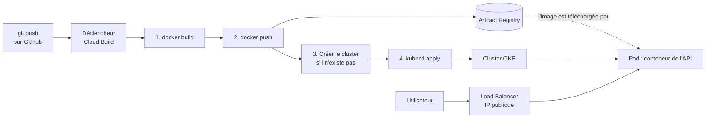

# GGAPi — de `git push` à Kubernetes, expliqué pas à pas

Ce dépôt contient une API de transcription audio (Whisper small) et toute la chaîne qui la met en ligne : **Docker**, **Cloud Build**, **Artifact Registry** et **GKE** (Kubernetes sur Google Cloud).

Ce README sert aussi de cours. Chaque fichier de configuration y est expliqué : ce qu'il fait, pourquoi il est écrit ainsi, et ce qu'il faut changer pour le réutiliser dans un autre projet.

---

## Sommaire

1. [Vue d'ensemble](#1-vue-densemble)
2. [Les fichiers du projet](#2-les-fichiers-du-projet)
3. [L'application : FastAPI + Whisper](#3-lapplication--fastapi--whisper)
4. [Les dépendances avec uv](#4-les-dépendances-avec-uv)
5. [Docker : empaqueter l'application](#5-docker--empaqueter-lapplication)
6. [Artifact Registry : stocker les images](#6-artifact-registry--stocker-les-images)
7. [Cloud Build : le pipeline CI/CD](#7-cloud-build--le-pipeline-cicd)
8. [Kubernetes et GKE : faire tourner l'API](#8-kubernetes-et-gke--faire-tourner-lapi)
9. [Le parcours complet d'un commit](#9-le-parcours-complet-dun-commit)
10. [Mise en place initiale (une seule fois)](#10-mise-en-place-initiale-une-seule-fois)
11. [Commandes utiles au quotidien](#11-commandes-utiles-au-quotidien)
12. [Dépannage](#12-dépannage)
13. [Coûts et nettoyage](#13-coûts-et-nettoyage)
14. [Réutiliser cette configuration dans un nouveau projet](#14-réutiliser-cette-configuration-dans-un-nouveau-projet)
15. [Glossaire](#15-glossaire)

---

## 1. Vue d'ensemble



En une phrase : **chaque `git push` construit une image Docker, la range dans Artifact Registry, puis demande à Kubernetes de remplacer les anciens conteneurs par des nouveaux, sans interruption.**

Chaque outil a un rôle précis :

| Outil | Rôle | Fichier |
|---|---|---|
| **uv** | Gérer Python et les dépendances | `pyproject.toml`, `uv.lock` |
| **Docker** | Empaqueter l'application et tout ce dont elle a besoin dans une *image* | `Dockerfile`, `.dockerignore` |
| **Artifact Registry** | Stocker les images (comme un GitHub pour les images Docker) | — |
| **Cloud Build** | Automatiser : construire, pousser, déployer | `cloudbuild.yaml` |
| **GKE / Kubernetes** | Faire tourner les conteneurs, les relancer s'ils plantent, les exposer sur Internet | `k8s/deployment.yaml` |

---

## 2. Les fichiers du projet

```
GGAPi/
├── src/ggapi/
│   ├── __init__.py
│   ├── main.py            # l'API FastAPI (routes / et /transcribe)
│   └── asr.py             # le chargement et l'appel de Whisper
├── k8s/
│   └── deployment.yaml    # ce que Kubernetes doit faire tourner
├── Dockerfile             # la recette de l'image
├── .dockerignore          # ce qu'on n'envoie pas dans l'image
├── cloudbuild.yaml        # le pipeline CI/CD
├── pyproject.toml         # le projet Python et ses dépendances
├── uv.lock                # les versions exactes de toutes les dépendances
├── requirements.txt       # les mêmes versions, au format pip (optionnel)
└── .python-version        # la version de Python (3.12)
```

---

## 3. L'application : FastAPI + Whisper

### `src/ggapi/main.py`

Ce fichier définit l'API avec **FastAPI** :

- `GET /` répond `{"message": "Hello from ggapi!"}`. C'est cette route que Kubernetes appelle pour savoir si l'API est prête (voir la *readinessProbe*, [section 8](#8-kubernetes-et-gke--faire-tourner-lapi)).
- `POST /transcribe` reçoit un fichier audio et renvoie `{"text": "..."}`. Le paramètre optionnel `language` (par exemple `french`) force la langue ; sans lui, Whisper la détecte seul.
- `main()` lance le serveur en local avec rechargement automatique. C'est ce que fait la commande `uv run ggapi`.

### `src/ggapi/asr.py`

- `get_pipeline()` charge le modèle `openai/whisper-small` **une seule fois**, à la première requête, grâce à `@lru_cache`. Les requêtes suivantes réutilisent le modèle déjà en mémoire.
- `transcribe()` décode l'audio avec `librosa`, le convertit en mono 16 kHz (le format attendu par Whisper), puis le transcrit. `chunk_length_s=30` découpe les fichiers longs en morceaux de 30 secondes.

> **À retenir :** le chargement du modèle prend du temps. La toute première requête sur un nouveau conteneur est donc lente (plusieurs secondes), les suivantes beaucoup moins.

### Lancer l'API en local

```bash
uv run ggapi
```

Puis ouvrir http://127.0.0.1:8000/docs : FastAPI génère une page qui permet de tester chaque route depuis le navigateur.

---

## 4. Les dépendances avec uv

**uv** remplace `pip`, `venv` et `pyenv` en un seul outil, beaucoup plus rapide.

### `pyproject.toml`

C'est la carte d'identité du projet :

```toml
[project]
name = "ggapi"
requires-python = ">=3.12"
dependencies = [ "fastapi>=0.162.0", "torch>=2.14.1", ... ]

[project.scripts]
ggapi = "ggapi.main:main"     # crée la commande `ggapi` → appelle main() dans main.py
```

Le passage le plus important pour le déploiement :

```toml
[[tool.uv.index]]
name = "pytorch-cpu"
url = "https://download.pytorch.org/whl/cpu"
explicit = true               # cet index ne sert QUE pour les paquets qui le demandent

[tool.uv.sources]
torch = { index = "pytorch-cpu" }
```

**Pourquoi ?** Sur Linux, le `torch` de PyPI embarque les bibliothèques NVIDIA CUDA (plusieurs Go). Notre cluster n'a pas de GPU : on prend donc la version **CPU**, beaucoup plus légère. L'image Docker est plus petite et se construit plus vite.

### `uv.lock`

Ce fichier contient **la version exacte de chaque paquet**, y compris les dépendances des dépendances. Il est généré automatiquement : ne pas le modifier à la main, mais le commiter. C'est grâce à lui que l'image construite par Cloud Build contient exactement les mêmes versions que votre machine.

### Commandes essentielles

```bash
uv add <paquet>         # ajoute une dépendance (met à jour pyproject.toml et uv.lock)
uv remove <paquet>      # la retire
uv sync                 # installe exactement ce qui est dans uv.lock
uv run <commande>       # lance une commande dans l'environnement du projet
```

### `requirements.txt`

Ce sont les mêmes versions que `uv.lock`, au format `pip`, pour les outils qui ne connaissent pas uv. **Le Dockerfile ne l'utilise pas.** Il n'est pas mis à jour automatiquement ; pour le régénérer :

```bash
uv export --format requirements-txt --no-hashes --no-dev --no-emit-project -o requirements.txt
```

puis rajouter à la main la ligne `--extra-index-url https://download.pytorch.org/whl/cpu` en haut du fichier.

---

## 5. Docker : empaqueter l'application

### Les notions

- **Image** : un paquet figé qui contient le système, Python, les dépendances, le code et le modèle. Elle se construit à partir du `Dockerfile`.
- **Conteneur** : une image *en train de tourner*. Une même image peut lancer autant de conteneurs qu'on veut.
- **Couche (layer)** : chaque instruction du Dockerfile produit une couche. Si une instruction et tout ce qui la précède n'ont pas changé, Docker réutilise la couche déjà construite (le *cache*) au lieu de la refaire.

### Le `Dockerfile` ligne par ligne

```dockerfile
FROM python:3.12-slim
```
L'image de départ : une Debian minimale avec Python 3.12. La variante `slim` est plus légère que l'image complète.

```dockerfile
COPY --from=ghcr.io/astral-sh/uv:0.13.4 /uv /bin/uv
```
Copie le binaire `uv` depuis l'image officielle d'uv. Pas besoin de l'installer avec `pip` ou `curl`. La version est fixée pour que le build soit reproductible.

```dockerfile
WORKDIR /app
```
Le dossier de travail dans l'image : toutes les commandes suivantes s'exécutent dans `/app`.

```dockerfile
ENV UV_COMPILE_BYTECODE=1 \
    UV_LINK_MODE=copy \
    HF_HOME=/app/hf \
    PATH="/app/.venv/bin:$PATH"
```
- `UV_COMPILE_BYTECODE=1` : précompile les fichiers Python en `.pyc`, pour un démarrage plus rapide.
- `UV_LINK_MODE=copy` : copie les fichiers au lieu de créer des liens, ce qui évite des avertissements dans Docker.
- `HF_HOME=/app/hf` : le dossier où Hugging Face range les modèles téléchargés.
- `PATH=...` : rend directement accessibles les commandes de l'environnement virtuel (`python`, `uvicorn`).

```dockerfile
COPY pyproject.toml uv.lock ./
RUN uv sync --frozen --no-dev --no-install-project
```
On installe **d'abord les dépendances seules**, sans le code. `--frozen` utilise `uv.lock` tel quel, sans rien mettre à jour ; `--no-dev` ignore les outils de développement ; `--no-install-project` n'installe pas encore notre propre code.

> **Pourquoi cet ordre ?** Le code change à chaque commit, les dépendances rarement. En les installant avant de copier le code, la couche des dépendances (la plus longue : torch, transformers…) reste en cache quand seul le code change. C'est vrai sur votre machine ; sur Cloud Build, chaque build part d'une machine neuve et n'a pas de cache par défaut (voir [section 7](#7-cloud-build--le-pipeline-cicd)).

```dockerfile
COPY README.md ./
COPY src ./src
RUN uv sync --frozen --no-dev
```
On copie le code, puis on installe le projet lui-même. `README.md` est nécessaire car `pyproject.toml` le déclare (`readme = "README.md"`).

```dockerfile
RUN python -c "from transformers import pipeline; pipeline('automatic-speech-recognition', model='openai/whisper-small')"
```
Télécharge le modèle Whisper **pendant le build**, dans `/app/hf`. Sans cette ligne, chaque nouveau conteneur téléchargerait ~1 Go au démarrage. L'image est plus lourde, mais les conteneurs démarrent plus vite et ne dépendent pas de Hugging Face en production.

```dockerfile
CMD ["sh", "-c", "uvicorn ggapi.main:app --host 0.0.0.0 --port ${PORT:-8080}"]
```
La commande lancée au démarrage du conteneur :
- `--host 0.0.0.0` : écoute sur toutes les interfaces. Avec `127.0.0.1`, l'API ne serait joignable que depuis l'intérieur du conteneur.
- `${PORT:-8080}` : utilise la variable `PORT` si elle existe, sinon 8080. Cloud Run fournit `PORT` automatiquement ; sur Kubernetes, c'est `k8s/deployment.yaml` qui la définit.
- `sh -c` est nécessaire pour que `${PORT}` soit remplacé par sa valeur : la forme `["uvicorn", ...]` seule ne passe pas par un shell.

### `.dockerignore`

```
.venv
.git
__pycache__
*.py[oc]
```
Ces fichiers ne sont pas envoyés à Docker pendant le build. `.venv` surtout : il est lourd, propre à votre machine, et l'image crée le sien.

### Tester l'image en local

```bash
docker build -t whisper-api .
docker run -p 8080:8080 whisper-api
# dans un autre terminal :
curl -F "file=@mon_audio.wav" http://localhost:8080/transcribe
```

Si Docker répond `permission denied ... docker.sock`, ajoutez votre utilisateur au groupe `docker`, puis fermez et rouvrez votre session :

```bash
sudo usermod -aG docker $USER
```

---

## 6. Artifact Registry : stocker les images

Artifact Registry est l'entrepôt d'images Docker de Google Cloud. Une image y est identifiée par une adresse de cette forme :

```
us-central1-docker.pkg.dev / PROJECT_ID / whisper-small / whisper-small-api : 7f3a...
└──────── région ────────┘   └ projet ┘   └─ dépôt ─┘     └─── image ────┘   └ tag ┘
```

- Le **dépôt** (`whisper-small`) doit être créé une fois à l'avance (voir [section 10](#10-mise-en-place-initiale-une-seule-fois)).
- Le **tag** distingue les versions d'une même image. Le pipeline en pose deux :
  - `$BUILD_ID` : unique pour chaque build. C'est lui qu'on déploie, pour savoir exactement quelle version tourne et pouvoir revenir en arrière.
  - `latest` : déplacé à chaque build, il désigne toujours la dernière version. Pratique pour tester à la main, mais à éviter en production, car on ne sait plus quelle version tourne.

---

## 7. Cloud Build : le pipeline CI/CD

### Les notions

- **Build** : une exécution du pipeline.
- **Étape (step)** : chaque étape tourne dans **son propre conteneur**, à partir de l'image indiquée par `name`. Les étapes s'exécutent dans l'ordre ; si l'une échoue, le build s'arrête.
- **`/workspace`** : le dossier partagé entre toutes les étapes. Il contient le code du dépôt GitHub. Ce qu'une étape y écrit est visible par les suivantes.
- **Déclencheur (trigger)** : la règle « à chaque push sur telle branche de tel dépôt GitHub, lancer un build avec `cloudbuild.yaml` ».

### Étape 1 — Build

```yaml
- name: 'gcr.io/cloud-builders/docker'
  args: ['build','-t','${_IMAGE_URI}:$BUILD_ID','-t','${_IMAGE_URI}:latest','.']
```
- `name` : l'image qui exécute l'étape, ici celle de Google qui contient Docker.
- `args` : les arguments passés à `docker`, soit `docker build -t ... -t ... .`.
- Le `.` final désigne le dossier courant (`/workspace`), qui doit contenir le `Dockerfile`. C'est pourquoi le build échouait avec `lstat /workspace/Dockerfile: no such file or directory` tant que le Dockerfile n'était pas poussé sur GitHub.

### Étape 2 — Push

```yaml
- name: 'gcr.io/cloud-builders/docker'
  args: ['push','--all-tags','${_IMAGE_URI}']
```
Envoie l'image et ses deux tags vers Artifact Registry. Cette étape est nécessaire **avant** le déploiement : le cluster va chercher l'image dans Artifact Registry, pas sur la machine de build.

### Étape 3 — Créer le cluster s'il n'existe pas

```yaml
- name: 'gcr.io/google.com/cloudsdktool/cloud-sdk'
  entrypoint: bash
  args:
  - '-c'
  - |
    gcloud container clusters describe ${_CLUSTER} --region ${_REGION} > /dev/null 2>&1 \
      || gcloud container clusters create-auto ${_CLUSTER} --region ${_REGION}
```
- `entrypoint: bash` remplace la commande par défaut de l'image ; `args: ['-c', '...']` donne à bash un script à exécuter.
- `|` en YAML introduit un bloc de texte sur plusieurs lignes, conservé tel quel.
- `describe ... || create-auto ...` : `describe` réussit si le cluster existe, et dans ce cas `||` n'exécute pas la suite. Sinon, `create-auto` crée un cluster **Autopilot**. Le premier build crée donc le cluster ; les suivants passent cette étape en une seconde.
- `> /dev/null 2>&1` masque la sortie de `describe`, qui serait inutile dans les logs.

### Étape 4 — Déployer

```yaml
- name: 'gcr.io/google.com/cloudsdktool/cloud-sdk'
  entrypoint: bash
  args:
  - '-c'
  - |
    gcloud container clusters get-credentials ${_CLUSTER} --region ${_REGION}
    sed "s|image: .*|image: ${_IMAGE_URI}:$BUILD_ID|" k8s/deployment.yaml | kubectl apply -f -
    kubectl rollout status deployment/whisper-small-api --timeout=15m
```
- On utilise l'image `cloud-sdk` **complète** et non `cloud-sdk:slim` : seule la version complète contient `kubectl`.
- `get-credentials` configure `kubectl` pour parler à notre cluster.
- `sed "s|image: .*|image: ...|"` remplace la ligne `image:` du manifeste par l'image **de ce build**. Le fichier sur disque n'est pas modifié : le résultat est envoyé directement à `kubectl`.
- `kubectl apply -f -` : le `-` signifie « lire le manifeste sur l'entrée standard », c'est-à-dire la sortie de `sed`.
- `kubectl rollout status` attend que les nouveaux pods soient prêts. Si le déploiement échoue (image introuvable, application qui plante…), cette commande échoue au bout de 15 minutes, donc **le build échoue aussi** : on le voit tout de suite dans Cloud Build.

> **Piège classique :** dans un script, Cloud Build remplace lui-même tout ce qui ressemble à `$VAR` ou `${VAR}` **avant** que bash ne s'exécute. Pour une variable du shell (et non une substitution Cloud Build), il faut écrire `$$VAR`. Exemple : `echo $$HOME`.

### Les substitutions (les variables)

```yaml
substitutions:
  _REGION: 'us-central1'
  _REPOSITORY: 'whisper-small'
  _IMAGE: 'whisper-small-api'
  _CLUSTER: 'whisper-cluster'
  _IMAGE_URI: '${_REGION}-docker.pkg.dev/${PROJECT_ID}/${_REPOSITORY}/${_IMAGE}'
```

Il en existe deux sortes :

| Type | Exemples | D'où viennent-elles ? |
|---|---|---|
| **Intégrées** | `$PROJECT_ID`, `$BUILD_ID`, `$COMMIT_SHA`, `$SHORT_SHA`, `$BRANCH_NAME` | Fournies automatiquement par Cloud Build (les trois dernières seulement pour un build lancé par un déclencheur) |
| **Personnalisées** | `_REGION`, `_CLUSTER`… | Définies par vous. **Leur nom doit commencer par `_`.** |

Les valeurs écrites dans `cloudbuild.yaml` sont des **valeurs par défaut**. On peut les remplacer sans modifier le fichier :

- **dans le déclencheur** : console Cloud Build → Déclencheurs → votre déclencheur → rubrique « Variables de substitution » ;
- **en ligne de commande** :
  ```bash
  gcloud builds submit --config cloudbuild.yaml \
    --substitutions=_REGION=europe-west1,_CLUSTER=mon-cluster
  ```

`_IMAGE_URI` est **calculée** à partir des autres. Cela n'est possible que grâce à l'option `dynamic_substitutions: true` (voir plus bas). Ainsi, l'adresse de l'image n'est écrite qu'à un seul endroit : si on change de région, tout suit.

### `images`, `timeout` et `options`

```yaml
images:
- '${_IMAGE_URI}:$BUILD_ID'
- '${_IMAGE_URI}:latest'
```
Liste les images produites par le build. Cloud Build les pousse à la fin du build (déjà présentes grâce à l'étape 2, l'envoi est quasi instantané) et les affiche dans les résultats du build, ce qui permet de retrouver quelle image vient de quel build.

```yaml
timeout: '3600s'
```
Durée maximale du build. La valeur par défaut, 10 minutes, ne suffit pas : la création du cluster prend 5 à 10 minutes, et le build de l'image (torch + modèle) plusieurs minutes.

```yaml
options:
  logging: CLOUD_LOGGING_ONLY
  dynamic_substitutions: true
```
- `logging: CLOUD_LOGGING_ONLY` : les logs vont uniquement dans Cloud Logging, sans bucket Cloud Storage à gérer.
- `dynamic_substitutions: true` : autorise une substitution à en utiliser d'autres (c'est le cas de `_IMAGE_URI`).

### Le cache Docker sur Cloud Build

Chaque build tourne sur une machine neuve : par défaut, **aucune couche n'est en cache**, et torch est réinstallé à chaque fois. Pour accélérer les builds plus tard, on peut réutiliser l'image `latest` comme cache avec `docker build --cache-from` ou utiliser Kaniko. C'est une optimisation, pas une obligation.

---

## 8. Kubernetes et GKE : faire tourner l'API

### Les notions

| Terme | Définition |
|---|---|
| **Cluster** | L'ensemble des machines gérées par Kubernetes |
| **Nœud (node)** | Une machine (VM) du cluster |
| **Pod** | La plus petite unité de Kubernetes : un ou plusieurs conteneurs qui tournent ensemble sur un nœud. Ici, un pod = un conteneur de l'API |
| **Deployment** | Décrit **l'état voulu** : « je veux N pods avec telle image ». Kubernetes s'assure en permanence que la réalité correspond : si un pod plante, il en recrée un |
| **Service** | Une adresse stable devant des pods dont les adresses changent à chaque redémarrage |
| **Label / selector** | Des étiquettes (`app: whisper-small-api`) qui relient les objets entre eux : le Deployment et le Service retrouvent « leurs » pods grâce à elles |
| **Manifeste** | Un fichier YAML qui décrit des objets Kubernetes (`k8s/deployment.yaml`) |

> **L'idée clé de Kubernetes** : on ne lui dit pas *quoi faire* (« lance un conteneur »), on lui décrit *l'état voulu* (« il doit y avoir 1 pod avec cette image »). `kubectl apply` envoie cet état ; Kubernetes fait ce qu'il faut pour y arriver, et continue de le maintenir.

### GKE Autopilot ou Standard ?

- **Standard** : vous choisissez et payez des machines (nœuds), même si elles sont vides.
- **Autopilot** (notre choix) : Google gère les nœuds. Vous déclarez seulement le CPU et la mémoire dont chaque pod a besoin, et vous payez ces ressources. Moins de réglages, moins de risques d'erreur.

### `k8s/deployment.yaml` — partie 1 : le Deployment

```yaml
apiVersion: apps/v1
kind: Deployment
metadata:
  name: whisper-small-api
```
Chaque objet Kubernetes a un type (`kind`), la version de l'API qui le décrit (`apiVersion`) et un nom (`metadata.name`).

```yaml
spec:
  replicas: 1
```
Le nombre de pods voulus. Passer à `2` fait tourner deux copies de l'API : plus de requêtes traitées en parallèle, et le service continue si un pod tombe.

```yaml
  selector:
    matchLabels:
      app: whisper-small-api
  template:
    metadata:
      labels:
        app: whisper-small-api
```
- `template` est le **modèle** des pods à créer.
- Chaque pod reçoit l'étiquette `app: whisper-small-api`.
- `selector` indique au Deployment quels pods lui appartiennent : ceux qui portent cette étiquette. Les deux doivent correspondre, sinon Kubernetes refuse le manifeste.

```yaml
      containers:
      - name: api
        image: us-central1-docker.pkg.dev/PROJECT_ID/whisper-small/whisper-small-api:latest
```
L'image à lancer. Cloud Build remplace cette ligne par l'image du build en cours (étape 4). Si vous appliquez le fichier à la main, remplacez `PROJECT_ID` par l'ID de votre projet.

```yaml
        ports:
        - containerPort: 8080
        env:
        - name: PORT
          value: "8080"
```
Le port sur lequel le conteneur écoute. La variable `PORT` est lue par la commande `CMD` du Dockerfile. Les valeurs de `env` sont toujours des chaînes de caractères, d'où les guillemets.

```yaml
        resources:
          requests:
            cpu: "2"
            memory: 4Gi
          limits:
            memory: 4Gi
```
- `requests` : ce que le pod **réserve**. Kubernetes ne le place que sur un nœud qui a cette quantité de libre. Sur Autopilot, c'est aussi **ce que vous payez**.
- `limits` : le maximum autorisé. Un pod qui dépasse sa limite de **mémoire** est tué (`OOMKilled`) puis relancé.
- Pourquoi 4 Gi ? torch + Whisper small occupent environ 2 à 3 Go une fois chargés. Avec la valeur par défaut, le pod serait tué au premier chargement du modèle.

```yaml
        readinessProbe:
          httpGet:
            path: /
            port: 8080
          initialDelaySeconds: 10
          periodSeconds: 10
```
La **sonde de disponibilité** : toutes les 10 secondes (après une attente initiale de 10 secondes), Kubernetes appelle `GET /`. Tant que l'API ne répond pas, le pod ne reçoit **aucun trafic**. Pendant une mise à jour, les anciens pods continuent donc de répondre jusqu'à ce que les nouveaux soient prêts : c'est ce qui permet un déploiement sans interruption.

> Il existe aussi une `livenessProbe`, qui **redémarre** un pod qui ne répond plus. Elle n'est pas utilisée ici ; à ajouter si l'API risque de se bloquer.

### `k8s/deployment.yaml` — partie 2 : le Service

```yaml
---
apiVersion: v1
kind: Service
metadata:
  name: whisper-small-api
spec:
  type: LoadBalancer
  selector:
    app: whisper-small-api
  ports:
  - port: 80
    targetPort: 8080
```
- `---` sépare deux objets dans un même fichier YAML.
- `selector` : le Service envoie le trafic aux pods qui portent l'étiquette `app: whisper-small-api`, quels qu'ils soient et où qu'ils soient.
- `type: LoadBalancer` : GKE crée un **équilibreur de charge Google Cloud avec une IP publique**. C'est cette adresse que vous donnez aux utilisateurs.
- `port: 80` → `targetPort: 8080` : le Service écoute sur le port 80 (le port HTTP standard, donc pas besoin de préciser le port dans l'URL) et transmet au port 8080 des conteneurs.

Autres types de Service à connaître : `ClusterIP` (accessible uniquement depuis l'intérieur du cluster, le type par défaut) et `NodePort`. Pour un vrai nom de domaine avec HTTPS, on ajoute un objet **Ingress** devant le Service.

### Comment se passe une mise à jour (rolling update)

Quand `kubectl apply` envoie un manifeste avec une nouvelle image :

1. Kubernetes crée un nouveau pod avec la nouvelle image.
2. Il attend que la `readinessProbe` de ce pod réussisse.
3. Il commence alors à envoyer le trafic au nouveau pod, puis arrête l'ancien.

Si le nouveau pod ne devient jamais prêt, l'ancien continue de servir les requêtes : une version cassée ne coupe pas le service.

---

## 9. Le parcours complet d'un commit

1. **Vous** : `git push` sur GitHub.
2. **Déclencheur Cloud Build** : il détecte le push et lance un build avec `cloudbuild.yaml`.
3. **FETCHSOURCE** : Cloud Build copie le code du commit dans `/workspace`.
4. **Étape 1** : `docker build` lit le `Dockerfile`, installe les dépendances, copie le code, télécharge Whisper → image taguée `:$BUILD_ID` et `:latest`.
5. **Étape 2** : `docker push` envoie l'image dans Artifact Registry.
6. **Étape 3** : le cluster existe déjà ? Rien à faire. Sinon, création (5 à 10 minutes).
7. **Étape 4** : `kubectl apply` envoie l'état voulu (« 1 pod avec l'image `:$BUILD_ID` ») au cluster.
8. **Kubernetes** : un nœud télécharge l'image depuis Artifact Registry et démarre le nouveau pod.
9. **readinessProbe** : dès que `GET /` répond, le pod reçoit le trafic et l'ancien est arrêté.
10. **`kubectl rollout status`** confirme que tout est prêt → le build est marqué **réussi**.
11. **Utilisateurs** : leurs requêtes vers `http://EXTERNAL-IP/` arrivent sur la nouvelle version.

---

## 10. Mise en place initiale (une seule fois)

Remplacez `PROJECT_ID` par l'ID de votre projet Google Cloud.

**1. Choisir le projet et activer les API nécessaires**

```bash
gcloud config set project PROJECT_ID
gcloud services enable \
  cloudbuild.googleapis.com \
  artifactregistry.googleapis.com \
  container.googleapis.com
```

**2. Créer le dépôt Artifact Registry**

Le nom et la région doivent correspondre à `_REPOSITORY` et `_REGION` dans `cloudbuild.yaml`.

```bash
gcloud artifacts repositories create whisper-small \
  --repository-format=docker \
  --location=us-central1
```

**3. Donner les droits au compte de service de Cloud Build**

Le pipeline agit au nom d'un **compte de service**. Celui de votre déclencheur est indiqué dans les paramètres du déclencheur. Selon l'âge du projet, c'est généralement `PROJECT_NUMBER@cloudbuild.gserviceaccount.com` ou le compte Compute Engine par défaut, `PROJECT_NUMBER-compute@developer.gserviceaccount.com`.

```bash
SA="serviceAccount:ADRESSE_DU_COMPTE_DE_SERVICE"
for ROLE in roles/container.admin roles/artifactregistry.writer \
            roles/iam.serviceAccountUser roles/logging.logWriter; do
  gcloud projects add-iam-policy-binding PROJECT_ID --member="$SA" --role="$ROLE"
done
```

| Rôle | Pourquoi |
|---|---|
| `roles/container.admin` | Créer le cluster et y déployer (étapes 3 et 4) |
| `roles/artifactregistry.writer` | Pousser l'image (étape 2) |
| `roles/iam.serviceAccountUser` | Permettre la création du cluster, qui utilise lui-même un compte de service |
| `roles/logging.logWriter` | Écrire les logs du build (`CLOUD_LOGGING_ONLY`) |

**4. Créer le déclencheur**

Console Google Cloud → **Cloud Build** → **Déclencheurs** → **Créer un déclencheur** :
- Source : le dépôt GitHub (`abdouaziz/test2`) et la branche (par exemple `^main$`)
- Configuration : *Fichier de configuration Cloud Build* → `cloudbuild.yaml`
- Variables de substitution : à remplir seulement pour changer les valeurs par défaut

**5. Installer `kubectl` sur votre machine** (pour surveiller le cluster)

```bash
gcloud components install kubectl gke-gcloud-auth-plugin
```

---

## 11. Commandes utiles au quotidien

### Se connecter au cluster

```bash
gcloud container clusters get-credentials whisper-cluster --region us-central1
```

### Observer

```bash
kubectl get pods                                  # les pods et leur état
kubectl get service whisper-small-api             # l'IP publique (EXTERNAL-IP)
kubectl describe pod <nom-du-pod>                 # détails et événements (très utile en cas d'erreur)
kubectl logs deployment/whisper-small-api         # les logs de l'API
kubectl logs -f deployment/whisper-small-api      # ... en continu
```

### Agir

```bash
kubectl scale deployment whisper-small-api --replicas=2     # passer à 2 pods
kubectl rollout undo deployment whisper-small-api           # revenir à la version précédente
kubectl rollout history deployment whisper-small-api        # l'historique des versions
kubectl rollout restart deployment whisper-small-api        # relancer tous les pods
```

> Attention : `scale` et `rollout undo` modifient le cluster directement. Le prochain `git push` réappliquera le manifeste du dépôt (`replicas: 1`, la nouvelle image). Pour un changement durable, modifiez `k8s/deployment.yaml`.

### Tester l'API déployée

```bash
curl http://EXTERNAL-IP/
curl -F "file=@mon_audio.wav" "http://EXTERNAL-IP/transcribe?language=french"
```

### Lancer un build sans passer par GitHub

```bash
gcloud builds submit --config cloudbuild.yaml
gcloud builds list --limit 5        # les derniers builds
gcloud builds log <BUILD_ID>        # les logs d'un build
```

---

## 12. Dépannage

| Symptôme | Cause probable | Solution |
|---|---|---|
| `lstat /workspace/Dockerfile: no such file or directory` | Le `Dockerfile` n'est pas dans le commit construit | `git add Dockerfile && git commit && git push` |
| `denied: Permission "artifactregistry.repositories.uploadArtifacts" denied` | Le compte de service ne peut pas pousser l'image, ou le dépôt n'existe pas | Créer le dépôt et donner `roles/artifactregistry.writer` ([section 10](#10-mise-en-place-initiale-une-seule-fois)) |
| `Required "container.clusters.create" permission` | Le compte de service ne peut pas créer le cluster | Donner `roles/container.admin` |
| `Kubernetes Engine API has not been used in project` | L'API GKE n'est pas activée | `gcloud services enable container.googleapis.com` |
| Build arrêté avec `TIMEOUT` | Le build dépasse `timeout` | Augmenter `timeout` dans `cloudbuild.yaml` |
| Pod en `Pending` plusieurs minutes | Autopilot ajoute une machine pour le pod | Normal au premier déploiement ; sinon voir `kubectl describe pod` |
| Pod en `ImagePullBackOff` | Mauvaise adresse d'image, ou le cluster ne peut pas lire Artifact Registry | Vérifier l'image avec `kubectl describe pod` et les droits du compte de service des nœuds |
| Pod en `CrashLoopBackOff` | L'application plante au démarrage | `kubectl logs <pod> --previous` pour voir l'erreur |
| Pod redémarre avec `OOMKilled` | Mémoire insuffisante | Augmenter `memory` dans `resources` |
| `EXTERNAL-IP` reste à `<pending>` | L'équilibreur de charge est en cours de création | Attendre 1 à 2 minutes |
| `kubectl rollout status` échoue après 15 minutes | Le nouveau pod ne devient jamais prêt | `kubectl describe pod` et `kubectl logs` ; l'ancienne version continue de tourner |
| Première transcription très lente | Le modèle se charge à la première requête | Normal ; les requêtes suivantes sont rapides |

**Réflexe numéro un : `kubectl describe pod <nom>`.** La section *Events* en bas de la sortie explique presque toujours le problème.

---

## 13. Coûts et nettoyage

Contrairement à Cloud Run, qui ne coûte rien sans requêtes, **un cluster GKE coûte en continu** :
- les ressources réservées par les pods (`requests` : 2 CPU, 4 Gi) ;
- les frais de gestion du cluster (GKE offre un crédit mensuel qui couvre un cluster Autopilot ou zonal par compte de facturation) ;
- l'équilibreur de charge et son IP publique ;
- le stockage des images dans Artifact Registry.

**Pour tout arrêter :**

```bash
# 1. Supprimer d'abord les objets Kubernetes (libère l'équilibreur de charge)
kubectl delete -f k8s/deployment.yaml

# 2. Supprimer le cluster
gcloud container clusters delete whisper-cluster --region us-central1

# 3. (optionnel) Supprimer les images
gcloud artifacts repositories delete whisper-small --location us-central1
```

Pensez aussi à désactiver le déclencheur : sinon, le prochain `git push` recréera le cluster.

---

## 14. Réutiliser cette configuration dans un nouveau projet

Checklist pour une nouvelle API Python :

**Application**
- [ ] L'API écoute sur `0.0.0.0` et sur le port donné par la variable `PORT`
- [ ] Elle a une route légère (comme `GET /`) pour la `readinessProbe`

**`Dockerfile`**
- [ ] Adapter la version de Python (`FROM python:3.X-slim`)
- [ ] Adapter la commande `CMD` (le module de l'application, par exemple `monapp.main:app`)
- [ ] Supprimer la ligne qui télécharge Whisper, ou la remplacer par le modèle du projet
- [ ] Copier les fichiers dont le build a besoin (`README.md` si `pyproject.toml` le déclare)

**`cloudbuild.yaml`**
- [ ] Changer `_REPOSITORY`, `_IMAGE`, `_CLUSTER` (et `_REGION` si besoin)
- [ ] Dans l'étape 4, changer `deployment/whisper-small-api` par le nom du nouveau Deployment

**`k8s/deployment.yaml`**
- [ ] Remplacer **tous** les `whisper-small-api` (nom, labels, selector du Service)
- [ ] Ajuster `resources` aux besoins réels de l'application (une petite API sans modèle : `cpu: 250m`, `memory: 512Mi`)
- [ ] Vérifier `containerPort`, `PORT` et `targetPort`

**Google Cloud**
- [ ] Créer le dépôt Artifact Registry
- [ ] Donner les rôles au compte de service
- [ ] Créer le déclencheur

**Pour aller plus loin**
- **Plusieurs environnements** (test / production) : un déclencheur par branche, avec des substitutions différentes (`_CLUSTER=cluster-test`…).
- **Nom de domaine et HTTPS** : ajouter un Ingress et un certificat géré par Google.
- **Secrets** (clés d'API, mots de passe) : Secret Manager ou les objets `Secret` de Kubernetes, jamais dans le code ni dans le Dockerfile.
- **Montée en charge automatique** : un `HorizontalPodAutoscaler` qui ajuste `replicas` selon l'utilisation CPU.
- **Plusieurs fichiers de manifestes** : Kustomize (intégré à `kubectl`) pour gérer des variantes par environnement sans `sed`.
- **Builds plus rapides** : cache Docker avec `--cache-from`.

---

## 15. Glossaire

| Terme | Définition |
|---|---|
| **CI/CD** | *Continuous Integration / Continuous Deployment* : construire, tester et déployer automatiquement à chaque modification du code |
| **Image** | Paquet figé contenant l'application et tout ce dont elle a besoin pour tourner |
| **Conteneur** | Une image en cours d'exécution |
| **Tag** | Étiquette qui distingue les versions d'une image (`:latest`, `:7f3a...`) |
| **Registry** | Entrepôt d'images (Artifact Registry, Docker Hub…) |
| **Cluster** | Ensemble de machines gérées par Kubernetes |
| **Nœud** | Une machine du cluster |
| **Pod** | Un ou plusieurs conteneurs qui tournent ensemble ; la plus petite unité de Kubernetes |
| **Deployment** | Objet Kubernetes qui maintient N pods identiques et gère leurs mises à jour |
| **Service** | Adresse réseau stable devant un groupe de pods |
| **Manifeste** | Fichier YAML qui décrit des objets Kubernetes |
| **Probe** | Vérification périodique de l'état d'un conteneur (*readiness* : prêt à recevoir du trafic ; *liveness* : toujours vivant) |
| **Rolling update** | Mise à jour progressive : les nouveaux pods remplacent les anciens sans interruption |
| **Substitution** | Variable de `cloudbuild.yaml`, remplacée par sa valeur au lancement du build |
| **Déclencheur (trigger)** | Règle qui lance un build automatiquement (par exemple à chaque push) |
| **Compte de service** | Identité utilisée par un programme (et non par une personne) pour agir sur Google Cloud |
| **IAM** | Le système de droits de Google Cloud : qui peut faire quoi sur quelle ressource |
| **Autopilot** | Mode de GKE où Google gère les machines ; on paie les ressources demandées par les pods |
| **OOMKilled** | *Out Of Memory* : conteneur tué parce qu'il a dépassé sa limite de mémoire |
